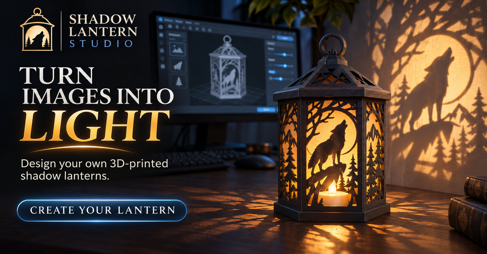
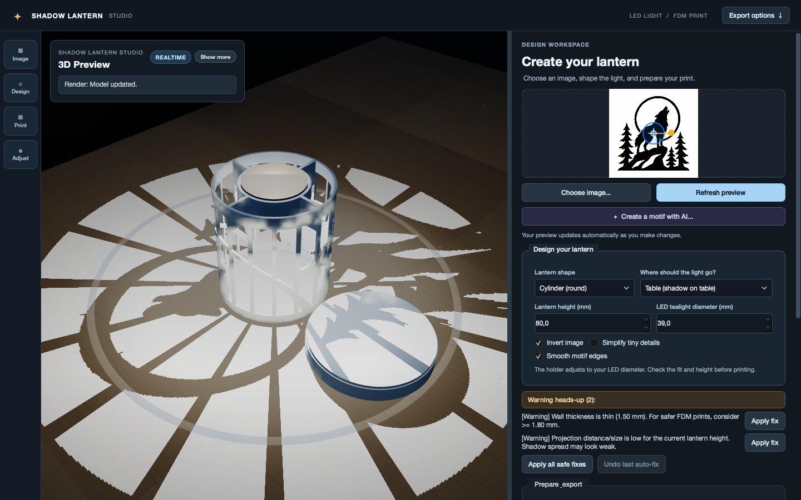

# Shadow Lantern Studio

**Turn images into light.** Create your own 3D-printable shadow lanterns from a
picture or an AI-generated motif.

*Concept artwork. The pictured lantern and interface are an illustration;
actual geometry, lighting and print results will vary. Use battery-powered LED
tealights only.*

## Download

Choose your package on the [v1.0.19 beta release page](https://github.com/mikaelmoran/ShadowLanternDownloads/releases/tag/v1.0.19-beta):

- **Windows:** `ShadowLanternStudio-v1.0.19-beta-windows.zip`
- **macOS — Apple Silicon:** `ShadowLanternStudio-v1.0.19-beta-macos-arm64.zip`
- **macOS — Intel:** `ShadowLanternStudio-v1.0.19-beta-macos-x64.zip`
- **Linux x64:** `ShadowLanternStudio-v1.0.19-beta-linux.zip`

Extract the ZIP completely. On macOS, open `ShadowLanternStudio.app`. On Windows,
open `ShadowLanternStudio.exe` from the extracted folder. On Linux, run the
`ShadowLanternStudio` executable from the extracted folder. Python is included
in the packaged app; you do not need to install it separately.

This is an **early beta**. The builds passed automated tests, but have not been
verified on every operating system, printer or computer. macOS may warn because
the app is not notarized by Apple; Windows may warn about an unfamiliar app.
Only open downloads you trust.

## Create your lantern

1. Choose an image or start with the included wolf motif.
2. Choose a shape, light direction, height and LED tealight diameter.
3. Adjust or compare the image options and inspect the 3D preview and warnings.
4. Export the lantern and lid as separate STL files.
5. Slice the STLs for your own printer and material, and inspect supports and layers before printing.

*The actual beta workspace.*

The **Classic lantern** option creates a square body with the motif on four
framed sides and a separate solid pitched roof lid with a hanging loop. Its
roof does not have the decorative cutouts pictured in the concept illustration.
Fine details may change when reinforced for FDM. Check the LED holder fit, lid
fit and loop strength with a test print.

## Slicer preview and supports

STL export and loading an existing G-code preview are available without a
slicer installation. The built-in **Slice selected part** preview requires a
separate [OrcaSlicer installation](https://github.com/OrcaSlicer/OrcaSlicer/releases)
and compatible Bambu Lab A1 profile JSON files; OrcaSlicer and its profiles are
not bundled. The A1 / 0.4 mm / PLA profile is an example for preview only.

Open **More print options → Configure OrcaSlicer** to select the executable and
the BBL JSON profile folder if they are not discovered automatically. The
folder must contain the matching machine, process and filament profiles and
their dependencies; the `resources/profiles/BBL` directory from a matching
OrcaSlicer source release is one source. Some OrcaSlicer installations contain
`.opc` archives rather than the JSON files needed here. The app cannot yet use
those archives directly. Compatibility varies by OrcaSlicer version.

Removable slicer supports are **not included** in exported STL files. Configure
supports again in your own slicer and inspect every layer. Reinforcement ribs
that are part of the lantern are included in its STL. Large toolpath previews
may omit paths and will show a warning. The app does not send jobs to a printer.

## Optional AI motifs

Choose **Create a motif with AI**, select OpenAI or Stability AI, enter your own
API key and describe a motif. The prompt and key are sent to the selected
provider only when you request generation. The app does not save the key;
generated images are saved locally. Provider API access may cost money and is
separate from a ChatGPT subscription. AI output still needs review for FDM
printability.

## Support the work

Shadow Lantern Studio is free. If you enjoy it, you can optionally [buy Mikael a coffee](https://buymeacoffee.com/mikaelmoran).

Made by Mikael Morán.
